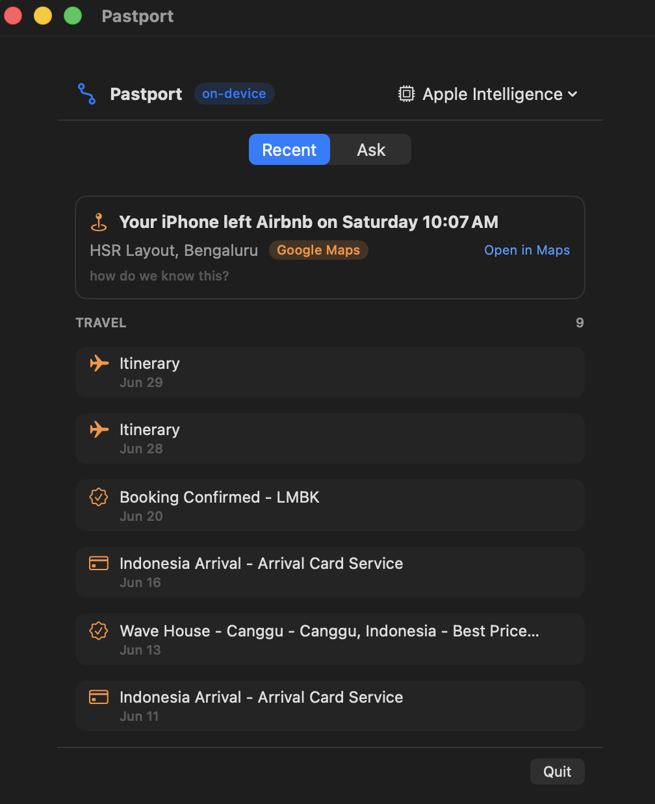

# Pastport

**Your browser history knows where you live. Pastport helps you read it.**

Pastport is a native macOS app and CLI for finding travel trails, bookings, threads, and trackers in your own Safari history. Safari analysis runs locally, behind Touch ID, with no cloud account or hosted database. Apple Foundation Models run on-device; local Ollama remains available for CLI phrasing. The separate Connected tools assistant can contact the services shown in each approval request.



## The boundary

Swift computes the facts. The on-device model only phrases a small evidence packet. If the evidence does not contain an answer, Pastport should say it does not know.

The live history database is copied to a temporary location and queried read-only. Query strings are stripped by default, sensitive threads are gated, and the history conversation has no network tools. Connected tools receive no Safari history.

## What it finds

- **Movements** — coordinates and timestamps carried by links.
- **Bookings** — booking-like pages, including confirmation and checkout URLs. A visit does not prove a purchase, reservation, or completed trip.
- **Threads** — short bursts of related activity.
- **Trackers** — redirects, interstitials, and attribution parameters.

## Install

Requires macOS 26 or later. Apple Foundation Models require Apple Intelligence enabled on a supported Mac. macOS 27 enables dynamic session profiles; macOS 26 uses a static profile. Download the signed, notarized app from the [latest release](https://github.com/anupamchugh/pastport/releases/latest), or build it yourself:

```bash
git clone https://github.com/anupamchugh/pastport
cd pastport
brew install xcodegen
./install.sh
```

The app starts with history and Photos closed. Choose **Read history**, then grant Full Disk Access to the app in System Settings if needed. Photos are optional: **Photo activity → Read photo activity** authenticates first and asks for Photos access only when you choose. It reads up to 500 local images, classifies ordinary photos on-device, and counts screenshots without inspecting their pixels. No iCloud image downloads are requested.

Choose **All retained history** in the model/window menu to remove the date cutoff. The coverage line shows unique visits, discovered Safari sources, retained dates, and whether the safety cap was reached. A failed source fails the read; a capped result is labelled partial. Safari may have already deleted older history, so this is not a lifetime record.

**Explore** starts with exact counts and source evidence, then offers research, travel, privacy, and places questions when matching evidence exists. **Ask → History** keeps a conversation over the authorized in-memory snapshot. Date-qualified questions narrow that snapshot; unsupported date phrases return no evidence rather than widening the query. History text is treated as untrusted source material.

Answers stream completed, validated sections from typed `@Generable` output. Each section cites a deterministic evidence field. Numeric checks reject unsupported counts and completed-booking claims; the source excerpts remain visible for checking model interpretations. These checks do not make every natural-language interpretation infallible.

**Session details** shows the profile mode, turn, measured duration, actual tool calls/results, per-turn token usage when available, and context occupancy labelled as tokenized or estimated. Context is rebuilt near its budget; macOS 27 can retain bounded complete turns. A new focus changes the dynamic profile and its small tool set. This profile describes the conversation workflow, not a personality inferred from browsing.

**Ask → Connected tools** is a separate conversation with optional Weather, Web, Calendar, Reminders, Contacts, Music, Location, Health, and Web Metadata tools from Foundation Lab. At most three tools can be selected. All start off. Each call shows its exact arguments, destination, and service and waits for approval. OS permissions are separate. Contacts, Calendar, Reminders, and Music are restricted to supported read operations; Health is unavailable when the platform reports no support. Lock, clear, or changing tools invalidates pending work. Web and Weather may use external services; Safari evidence is not included in that conversation.

The implementation pins [FoundationModelsKit](https://github.com/rryam/FoundationModelsKit) and [Foundation Lab](https://github.com/rudrankriyam/Foundation-Models-Framework-Lab) in `Package.resolved`. It follows Apple's [dynamic-session API](https://developer.apple.com/documentation/foundationmodels/composing-dynamic-sessions) and native Foundation Models tools; no MCP server is required for these in-app tools.

**Export to Foundation Lab** saves an explicit JSON experiment containing category counts and coverage only. It excludes URLs, titles, searches, coordinates, and answers. Import that file in Foundation Lab's Library to inspect and run an on-device experiment; the import does not grant Safari access or execute automatically. The exported file persists until you delete it.

**Lock & clear** clears cached history, photo activity and answers in both the window and menu-bar panel. Screen lock does the same. Changing the date range clears old evidence before another read.

The source installer creates an ad-hoc-signed local development build, not a notarized distribution. The safe demo mode never reads Safari history:

```bash
./install.sh --demo
```

## CLI

```bash
pastport recent
pastport bookings
pastport trail
pastport trackers
pastport photos --days 30
pastport agent --all "Which booking-like pages appear, and what do they prove?"
pastport eval --runs 3
```

`recent`, `search`, `top`, `when`, `stats`, `bookings`, and `trackers` run without a model. `brief`, `trail`, `threads`, `ask`, `agent`, and `eval` can use Apple Foundation Models or local Ollama.

## Build a DMG

Use Xcode and XcodeGen. To produce an explicitly labelled local preview without distribution credentials:

```bash
./package-release.sh --unsigned-preview
```

For a public distribution, supply your Developer ID identity and either existing `asc` authentication or a notarytool keychain profile:

```bash
./package-release.sh --sign 'Developer ID Application: Your Name (TEAMID)' --asc
# Or use an existing notarytool keychain profile:
./package-release.sh --sign 'Developer ID Application: Your Name (TEAMID)' --notary-profile YOUR_PROFILE
```

The script builds the native app, checks its version, creates DMG and ZIP artifacts and a SHA-256 manifest. The signed path notarizes and staples both the app and DMG and runs Gatekeeper verification. It never installs the app or publishes to GitHub. Unsigned previews are not suitable for public distribution.

## Development

```bash
swift test
```

Detectors use synthetic visits and wire-format shape, not brand-name lists. Contributions should preserve that rule.

MIT licensed.
