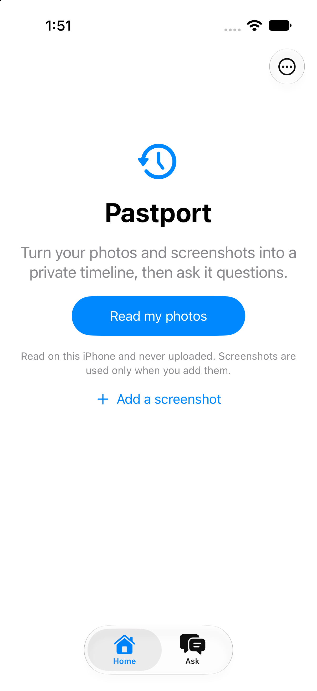
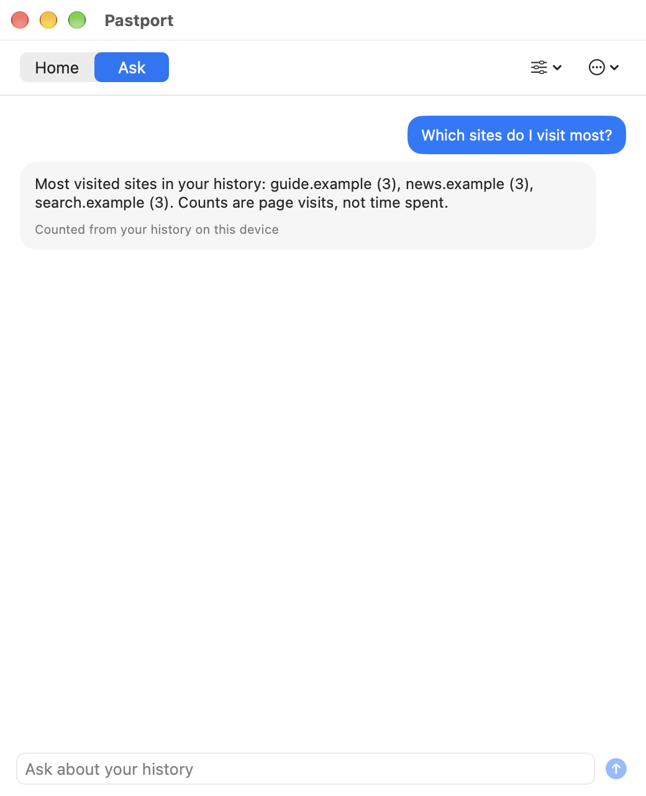
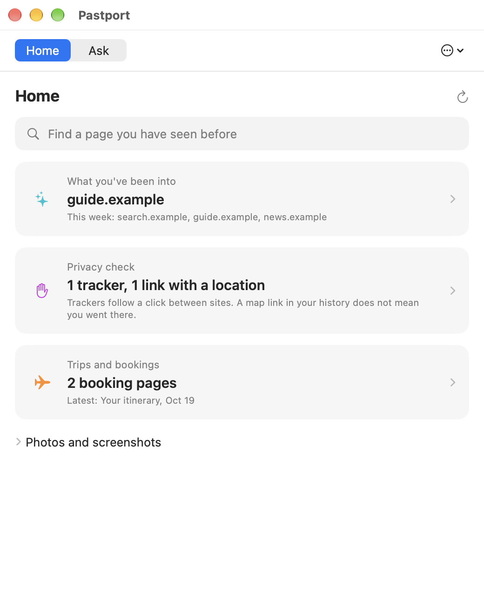
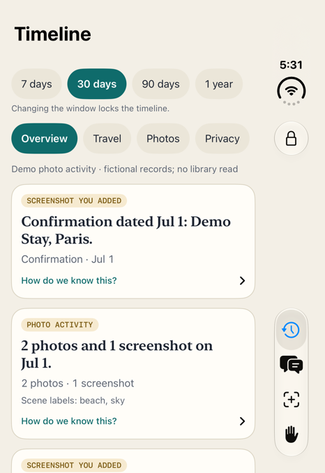
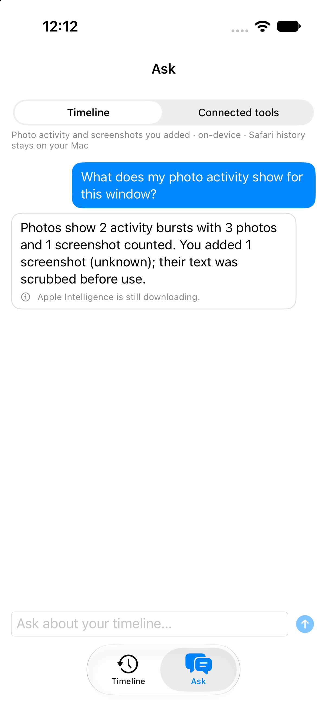
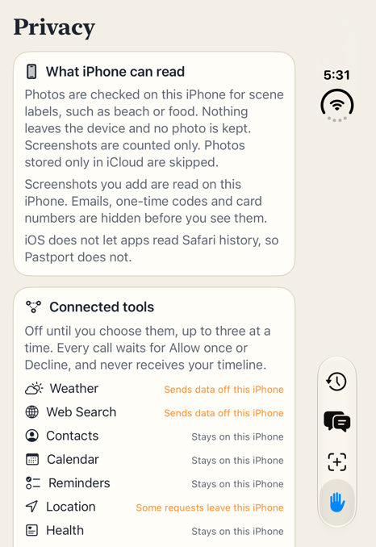

# Pastport vision

Pastport helps you find anything you have seen before. On the Mac it reads your Safari history in plain words, privately; on iPhone and iPad, where iOS does not let apps read Safari, it builds a timeline from photo activity and screenshots you add. Swift computes every fact, and the on-device model only words a small evidence packet. It reads and answers; it never acts for you.

Use this file to say yes or no to a feature. Each principle cites what already shipped on `origin/main`. The screenshots are real builds in demo mode: fictional records (`.example` domains, "Demo Stay, Paris"), never your Safari history or library. Some were taken on 21 and 22 Oct (`1c5670f` and the Duo run), before the 1.4 Mac candidate, so a few screens have since gained features. Concept images and prototypes stay outside this repo and must pass these principles before they are built.

## Principles

### 1. Closed until you open it

The app starts with history and photos closed. Reading needs an explicit action and a Face ID, Touch ID or passcode check; photos ask for permission only when you choose to read them. Lock & clear, screen lock and leaving the iPhone app drop everything that was read, and changing the date window locks the timeline again. Safari history is copied to a temporary file and queried read-only.

Shipped: `SessionLock` and the lock and clear paths; `b4cf65d` and `de89e6f` the unlock state and locked screen with window chips; `bd524a8` Siri hands Ask a question on the locked screen; `6876791` the Open Timeline intent opens the locked screen and returns no data.

### 2. Swift counts; the model only words it

Counts, dates, sources and coverage come from deterministic code. The model gets a small evidence packet, returns a typed `@Generable` answer in sections that each cite an evidence field, and the answer is kept only when every number in it appears in the evidence. When the evidence has no answer, Pastport says it does not know. Answers stream, can be stopped and list the tools they used. History text is treated as untrusted.

Shipped: `0c5aee5` an Evaluations suite for Ask Pastport; `7687a1e` question wording no longer discards the evidence; `eff091e` bounded Ask responses; `d782076` generated and fallback answers are labelled; `bd524a8` iPhone Ask overclaims fixed.

### 3. A visit is not proof

The app never turns a page into a story it cannot back. A booking page is not a purchase or a trip, a map link in your history does not mean you went there, and a tracker is a redirect, not an accusation. The Calendar export saves a real `.ics` file and no longer claims a confirmed booking. Each card on the iPhone says "How do we know this?" and lists the evidence.

Shipped: `ae66933` calendar export stops claiming a confirmed booking; `0f9e975`, `d563baa` and `748b3f4` evidence cards and Travel trail booking cards; `1409287` booking detection from screenshots; the numeric check rejects completed-booking claims (README), and `docs/intelligence-directions.md` states the rule for new ideas.

### 4. Say what the platform will not give you

iOS does not allow apps to read Safari history, and the iPhone app says so on its Timeline and Privacy screens instead of faking it. Without Apple Intelligence, Ask still replies with the recorded facts and says why it is not answering in words ("Apple Intelligence is still downloading"). Screenshots are counted from metadata and never inspected unless you add one; added screenshots are read on the device and emails, one-time codes and card numbers are replaced before they are shown.

Shipped: `ScreenshotReader` and the scrub pass; `PhotoEvents`; the fallback in `TimelineAssistant`; `PRODUCT.md` and the 21 Oct spec keep Safari import on iPhone out of scope.

### 5. What leaves the device is labelled and approved

Nothing from Safari history or the timeline leaves the device. Connected tools are a separate assistant: all off by default, at most three at once, no write tools, and every call shows its exact arguments and destination and waits for Allow once or Decline. Each tool carries a label, "Stays on this iPhone", "Some requests leave this iPhone" or "Sends data off this iPhone", and a Connected tool never receives your timeline. The Foundation Lab export holds category counts and coverage only. The optional Alfred view reads repository names from a helper you select, not clipboard text.

Shipped: `71f243c` tier labels on Connected tools; `ConnectedAssistant` approvals with a receipt for each call; `4508959` opt-in Batmobile Alfred references; `1634e58` cancellation of Alfred scans is verified.

### 6. Nothing flashes, and it fits any window

The owner has epilepsy: the code has no custom animation, and any streamed text added later has to appear all at once under Reduce Motion. Text uses system text styles, and the iPhone layout is chosen from size class and width, never from the device or orientation: a regular-width window shows Timeline beside Ask, and the Duo layout uses a tab per pair.

Shipped: `07313e5`, `30fe3a1` and `45d8b07` the size-class panes and Duo review fixes; `PaneLayout` with its tests.

Gap: `DESIGN.md` lists fixed-width icon and label columns that have not been checked at accessibility text sizes, no control sets an explicit 44 pt minimum, and the Reduce Motion switch for streamed text is a spec item, not code.

## What Pastport refuses to become

- A surveillance or analytics tool. No account, server, upload or tracking; Safari analysis stays on the Mac.
- A verifier of your past. It never says you read, bought, booked or visited something because a page was opened.
- An answer engine that guesses. With no evidence it says it does not know.
- An agent that acts. Connected tools are read-only, off by default and approved call by call; nothing is written to Calendar, Reminders, Contacts or Health.
- A second Safari. It does not browse, sync or keep a long-term copy; the history snapshot is in memory and clears on lock.
- A place for private screenshots to leak. An added screenshot is not kept, and its text is scrubbed before it is shown or used.

## How a new idea gets in

1. Check it against the principles above; if it breaks one, it doesn't ship, or the principle changes here first.
2. A concept image, prototype or `docs/intelligence-directions.md` idea may show it, but a proposal is not evidence.
3. Build it, then prove it with tests (the evidence and the numeric check, with the model faked), an Evaluations case where the model words the answer, and a demo-mode screenshot of the real view. Add that image here if it shows a principle better than the current one.

## Concepts (not built)

These live outside this repo and are linked, not copied. None of them is evidence that a feature exists.

- `/Users/anupamchugh/Desktop/workspace/design-assets/prototypes/pastport-iphone-prototype.pdf`: concept, not built as drawn. The Claude iPhone prototype (21 Oct, sample data) behind the 2.0 spec. The Face ID error banner, redaction bars and Privacy approval card were mock-ups; the Timeline trails, evidence cards and Privacy screen it led to have since been built, in different forms (see the screenshots above).
- `/Users/anupamchugh/Desktop/workspace/_notes/prototype-vs-reality-2026-10-25/img/pastport-proto-timeline.webp`: concept, not built as drawn. The prototype's Timeline screen.
- `/Users/anupamchugh/Desktop/workspace/_notes/prototype-vs-reality-2026-10-25/img/pastport-proto-ask.webp`: concept, not built as drawn. The prototype's Ask screen.
- Ideas in `docs/intelligence-directions.md`, none implemented: a return ticket, regular stops, a research itinerary, then and now, a source passport, private bookmarks, visual recall, Visual Intelligence search and a Codex companion over MCP (`pastport-7t3`). Each must define storage, lock behaviour and redaction first.
- Not built: Safari history import on iPhone (`docs/specs/2026-11-04-safari-history-import.md`, bead `pastport-4m8`), iCloud sync, widgets, Apple Watch.
